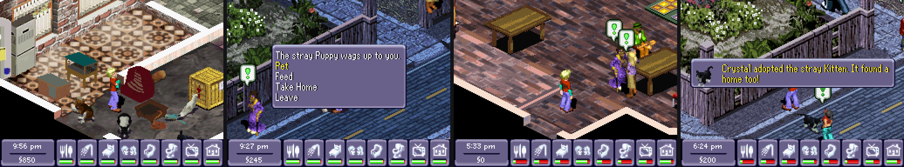

# Urbz DX

A fan-made ROM hack of *The Urbz: Sims in the City* for the Nintendo DS, and the mod kit it's made with. Urbz DX
is a city where the townspeople live their own lives, pets you can adopt and look after, and new furniture.
It's not the original game, and not made by EA: in an emulator's game list it shows as **Urbz DX**.



The kit unpacks your own copy of the game into editable files (text, pictures, colours, fonts, the game's
code), lets mods change them, and builds a new ROM. Built with no mods, it reproduces the original
byte-for-byte. Mods can be switched on and off inside the game, keep their own data in your save, and can be
written in C against a documented map of the game's engine.

**No game files are in this repository.** You need your own dump of the USA ROM.

## What's in Urbz DX

Urbz DX is made of mods you can pick from (all of them by default):

| Mod | What it does |
|---|---|
| **NPC Life** | The 36 townspeople follow daily routines: they eat, sit, wash, sleep, chat with each other and wander the city's cafés, clubs and parks in their free time, where you can see them. Everyone gets the animations they need. |
| **Pets** | Eight pets (Puppy, Kitten, Bunny, Hamster, Guinea Pig, Cockatoo, Macaw, Snake) with beds and cages. Win over a stray in Urbania Park, buy more at the Farmer's Market, feed, pet and play with them; they're saved and move house with you. |
| **More Furniture** | 13 new pieces (armchairs, sofas, beds, tables...), some with new actions (Read a Book, Nap, Daydream). |
| **Bug Fixes** | Fixes bugs in the original game, e.g. townspeople left pacing by a door or lift for hours when you stand near it. [List](mods/bug-fixes/README.md). |
| **Max Needs** | A testing aid, off until you switch it on in the game: your needs stay full while it's on. |

What each one does in detail: [docs/playing.md](docs/playing.md).

All you need is your Urbz ROM: the pets, their beds and the furniture are the kit's own 3D models
(`kit/urbz_models.py`), drawn in the Urbz style when you build. If you also own *The Sims 2: Apartment Pets* or
*The Sims 3* (DS), you can have them drawn from those games' models instead (optional, see
[docs/modding.md](docs/modding.md#importing-from-other-sims-games)).

## Getting started

You need:
- **Your Urbz DS ROM**, USA version (`Urbz, The - Sims in the City (USA)`, SHA1
  `3c01cc5cf3491b5d0ab626ccfb5bcad370662f2f`).
- **Python 3.9 or newer** (Windows: from [python.org](https://www.python.org/downloads/); tick "Add python.exe
  to PATH" while installing).
- **A DS emulator**: [melonDS](https://melonds.kuribo64.net/) is what the mods are tested on.

### Windows

1. Download this repository (the green **Code** button, then **Download ZIP**) and unzip it somewhere, or
   `git clone` it.
2. Double-click **`setup.bat`**: installs the Python packages (once).
3. Drag your ROM onto **`extract.bat`** (or run `extract.bat "C:\path\to\Urbz.nds"`): unpacks it into
   `project\` (about 40 s, once).
4. Put the full path of your emulator's `.exe` in a file called `emulator.txt` in the kit folder.
5. Double-click **`manager.bat`**: tick the mods you want, press **Build & Play**. You get
   `build\Urbz DX.nds`.


The first build takes a few minutes (it renders the pets, furniture and borrowed animations); later builds
take seconds. Your save lives next to the built ROM (`build\Urbz DX.sav`), and rebuilding never touches it.

### Linux / macOS

```
pip install -r requirements.txt
python urbz.py extract "Urbz.nds" project
python urbz.py build --vanilla          # check: prints [IDENTICAL to original]
python urbz.py manager                  # the mod manager window (needs tkinter)
python urbz.py build                    # or build the mods listed in mods.json
```

`python urbz.py` lists every tool. More on playing (handy saves, controls, the in-game Mods page):
[docs/playing.md](docs/playing.md).

## Making mods

Everything a mod can change, with examples: **[docs/modding.md](docs/modding.md)**. In short:

- **Text, pictures, colours, fonts:** export the game's own as plain text and PNG, edit, build.
- **Objects and pets:** describe new ones in `objects.json` / `pets.json`; the builder makes room in the game's
  tables, shops and catalog.
- **Code:** write C against `code/include/game.h` (the clock, needs, money, people, objects...) and hook it
  into the game in `hooks.txt`; or patch numbers with no compiler at all.
- **Townspeople:** draw new animations for anyone, or tune where NPC Life sends people.

How the game works inside (every address, table and format we know, and how we know it):
[docs/systems.md](docs/systems.md). All the docs: [docs/README.md](docs/README.md).

## Repository layout

| Path | What it is |
|---|---|
| `urbz.py` | The one command: `python urbz.py <tool> ...` |
| `*.bat` | Windows shortcuts: `setup`, `extract`, `manager`, `build`, `catalog`, `verify` |
| `kit/` | The tools (extract, build, mods, text, PNG, palettes, fonts, saves, C code, pets, objects, poses...) |
| `mods/` | The mods. Each holds only what it changes or adds |
| `code/` | The C side: the mod core (in-game switches, saved data, the Mods page), the game header and symbol map |
| `docs/` | Guides and the engine reference |
| `tests/` | Emulator proofs that check the kit and every documented fact |
| `verify/` | The headless emulator harness, test saves and scripts |
| `research/` | The probes behind the docs, kept as a record |
| `project/`, `build/` | Your unpacked game and built ROMs (created locally, never committed) |

## Contributing

Bug reports, mods, docs and code are all welcome. Start with [CONTRIBUTING.md](CONTRIBUTING.md): how to set up,
run the tests, and the few rules (above all: never commit anything from the game itself).

## Legal

This is a fan project. It is not made, approved or supported by Electronic Arts, Maxis, Griptonite or
Nintendo. *The Urbz*, *The Sims* and their names, characters and art belong to their owners. The repository
contains only original code and documentation, plus a few screenshots; the game, and anything taken from it,
stays on your computer. Use your own legally dumped copy.

The kit's code and docs are under the [MIT license](LICENSE).
